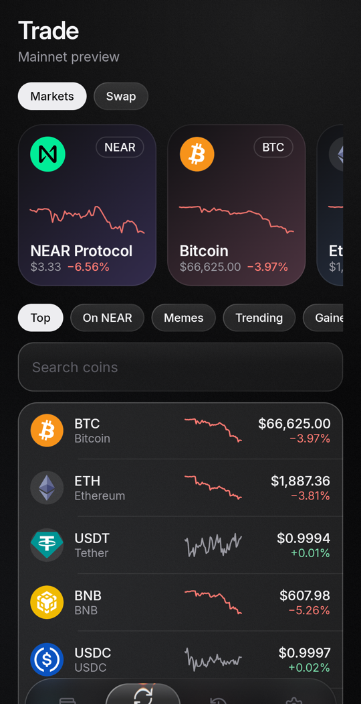

<p align="center">
  
</p>

<p align="center">
  
  
  
  
</p>

<p align="center">
  <b>Demo video:</b> <a href="https://x.com/Dev_anik2003/status/2121738890994405546">x.com/Dev_anik2003/status/2121738890994405546</a>
</p>

<br>

<table>
  <tr>
    <td align="center" width="33%"><br><sub><b>Markets</b> · live prices and charts</sub></td>
    <td align="center" width="33%"><br><sub><b>Swap</b> · any token, any chain</sub></td>
    <td align="center" width="33%"><br><sub><b>Coin page</b> · scrub the chart</sub></td>
  </tr>
</table>

<br>

## The problem

Hardware wallets cost money and are one more device to carry. Seed phrases get
lost, photographed or phished. Most people already carry a secure chip that
can sign: the contactless bank card in their wallet. Aegis makes that card
the hardware key for a NEAR account, so no seed phrase and no extra device are needed.

## How NEAR fits

- **The contract is the wallet.** A Rust contract is deployed to each wallet's
  own NEAR account. It checks the card's EMV RSA signature and the phone's
  P-256 signature on chain, and enforces limits, delays and freeze.
- **No key left behind.** Setup deletes the account's own access key, so only
  the contract's rules can move funds.
- **Named accounts** make the wallet readable; **NEAR Intents** (1Click) powers
  cross-chain swaps (mainnet only; read-only preview on testnet).

## How it works

| | | |
|:---:|---|---|
| **1** | **Tap your card** | The chip in any contactless bank card signs, like it does at a shop. No PIN, no payment. |
| **2** | **Touch your phone** | A key locked in the phone's secure hardware signs with your fingerprint. |
| **3** | **The chain checks both** | A contract on NEAR verifies the two signatures and enforces your limits. No one else holds a key. |

A stolen card alone can't move funds. A stolen phone alone can't either.

## What you get

- **No seed phrase.** The card you already carry is your backup.
- **Limits on chain.** Small payments go instantly; big ones wait, and you can cancel or freeze.
- **Recovery.** Lose your phone or card and recover with the other, plus a guardian.
- **Inheritance.** Name an heir; after a long silence, only they can receive the wallet.
- **Trade.** Markets, charts and swaps across chains through NEAR Intents. On testnet it's a live mainnet preview, and nothing is sent.

## Try it: do X, see Y

No phone needed for steps 1-4.

1. **Run the contract and core tests.** `cargo test` → every suite ends in
   `test result: ok` (core 22 unit + 7 EMV vectors, contract flows 37, vectors 1).
2. **Run the Kotlin client tests.** `cd android && export JAVA_HOME="$(/usr/libexec/java_home -v 17)" && ./gradlew :core:test`
   → `BUILD SUCCESSFUL` (EMV, multi-card, phases 2-5, vectors, inheritance, markets).
3. **Create and use a real testnet wallet with a simulated card.**
   `cd android && TAPVAULT_TESTNET=1 ./gradlew :core:test --tests '*TestnetE2E*' --rerun`
   → `[e2e] …` lines, ending in `[e2e] done. wallet: https://testnet.nearblocks.io/address/tv-e2e-…`.
   Open the link: the contract, the setup transactions, the payment.
4. **Check a wallet holds no keys.** View access keys of `tv-e2e-cc807a553f.testnet`
   (command in [AGENTS.md](AGENTS.md#checking-the-shipped-build-and-a-wallet-on-chain))
   → an empty `keys` list; its `code_hash` is `93djY2LQU6NbNHJ93GmCDtKXecdrZhQPVCZTUcWt1Kxy`.
5. **On a phone (Android 9+, NFC, screen lock).** Build and install (below), then
   **Check my card** → hold a contactless card → badge **Can sign**.
   **Create wallet** → hold the card, approve with fingerprint → "Your wallet is ready".
   **Send** 0.5 NEAR → fingerprint, tap card → "Sent 0.5 NEAR". Send 1.5 NEAR → "Waits 1 h · you can cancel it".
   Full script: [docs/DEMO.md](docs/DEMO.md).

## Build the app

```bash
android/build-apk.sh
adb install -r android/app/build/outputs/apk/debug/app-debug.apk
```

Needs JDK 17, the Android SDK, and a phone with NFC and a screen lock.
Details: [docs/ANDROID.md](docs/ANDROID.md).

```bash
cargo test                          # contract and core
cd android && ./gradlew :core:test  # Kotlin client
```

## Status

Works end to end on NEAR testnet with simulated cards. **Not yet tested with a
real bank card on a real phone**, so mainnet is off. Full picture:
[docs/STATUS.md](docs/STATUS.md).

## Contract build

Every new wallet runs `contract/res/tapvault_contract.wasm`:

| | |
|---|---|
| `code_hash` (base58) | `93djY2LQU6NbNHJ93GmCDtKXecdrZhQPVCZTUcWt1Kxy` |
| SHA-256 (hex) | `778a310ad4db8a87d6d0d52e8509d7ea4f5014782a0832106ab1cd2946e582c6` |
| Size | 369,809 bytes |

Older wallets keep the code they were created with. How to ship a new build:
[contract/res/README.md](contract/res/README.md).

## Libraries used

- **Contract (Rust):** near-sdk 5.14, p256 0.13 (ECDSA verify); tests: near-workspaces 0.20 (sandbox nearcore 2.6.5), tokio, anyhow, serde_json. `crates/tapvault-core` (RSA, SHA-1/256, EMV, policy) has no dependencies.
- **Android (Kotlin):** Jetpack Compose (BOM 2024.12.01), androidx activity-compose, lifecycle-viewmodel-compose, fragment-ktx, biometric 1.1.0; kotlinx-coroutines 1.9.0, kotlinx-serialization-json 1.7.3; Bouncy Castle 1.79; ZXing 3.5.3 (QR); Haze 1.5.4 (blur).
- **Services:** NEAR testnet RPCs and faucet, FastNEAR, NEAR Intents 1Click, CoinGecko and GeckoTerminal (market data).
- **Tooling:** cargo-near 0.17.0, Gradle 8.11.1, AGP 8.7.3, Kotlin 2.1.0. Parts of the code were written with AI coding assistants.

## Disclosures

- **Other chains (Q-002):** Aegis was built for NEAR; it did not exist on another chain before.
- **Other entries (Q-015):** Aegis is our only NEAR HACKATHON project.
- **Earlier name:** the project was called Tapvault until 14 Nov 2026; code and protocol names keep `tapvault`.

## Learn more

[Overview](docs/OVERVIEW.md) · [Design and threat model](docs/DESIGN.md) ·
[Cards](docs/CARDS.md) · [Testing](docs/TESTING.md) ·
[All docs](docs/README.md) · [For contributors](AGENTS.md)

<br>

<p align="center"><sub>Built for NEAR HACKATHON 2026 · MIT</sub></p>
