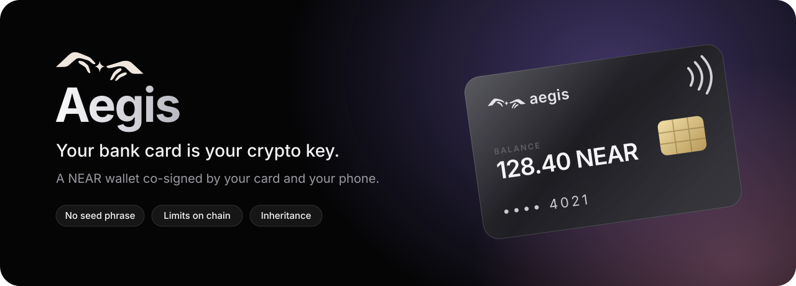
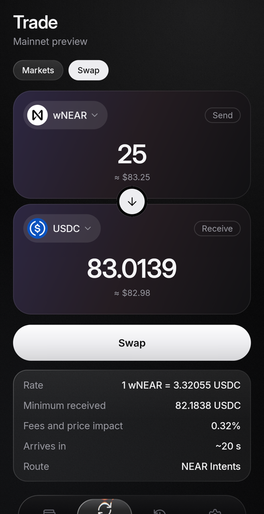
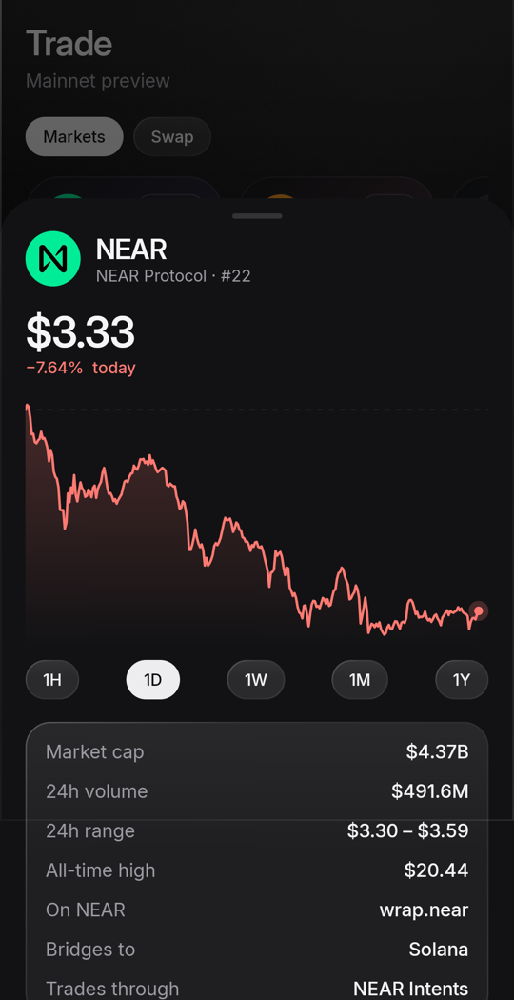

<p align="center">
  
</p>

<p align="center">
  
  
  
  
</p>

<br>

<table>
  <tr>
    <td align="center" width="33%"><br><sub><b>Markets</b> · live prices and charts</sub></td>
    <td align="center" width="33%"><br><sub><b>Swap</b> · any token, any chain</sub></td>
    <td align="center" width="33%"><br><sub><b>Coin page</b> · scrub the chart</sub></td>
  </tr>
</table>

<br>

## How it works

| | | |
|:---:|---|---|
| **1** | **Tap your card** | The chip in any contactless bank card signs, like it does at a shop. No PIN, no payment. |
| **2** | **Touch your phone** | A key locked in the phone's secure hardware signs with your fingerprint. |
| **3** | **The chain checks both** | A contract on NEAR verifies the two signatures and enforces your limits. No one else holds a key. |

A stolen card alone can't move funds. A stolen phone alone can't either.

## What you get

- **No seed phrase.** The card you already carry is your backup.
- **Limits on chain.** Small payments go instantly; big ones wait, and you can cancel or freeze.
- **Recovery.** Lose your phone or card and recover with the other, plus a guardian.
- **Inheritance.** Name an heir; after a long silence, only they can receive the wallet.
- **Trade.** Markets, charts and swaps across chains through NEAR Intents. On testnet it's a live mainnet preview, and nothing is sent.

## Try it

```bash
android/build-apk.sh
adb install -r android/app/build/outputs/apk/debug/app-debug.apk
```

Needs JDK 17, the Android SDK, and a phone with NFC and a screen lock.
Details: [docs/ANDROID.md](docs/ANDROID.md).

```bash
cargo test                          # contract and core
cd android && ./gradlew :core:test  # Kotlin client
```

## Status

Works end to end on NEAR testnet with simulated cards. **Not yet tested with a
real bank card on a real phone**, so mainnet is off. Full picture:
[docs/STATUS.md](docs/STATUS.md).

## Contract build

Every new wallet runs `contract/res/tapvault_contract.wasm`:

| | |
|---|---|
| `code_hash` (base58) | `93djY2LQU6NbNHJ93GmCDtKXecdrZhQPVCZTUcWt1Kxy` |
| SHA-256 (hex) | `778a310ad4db8a87d6d0d52e8509d7ea4f5014782a0832106ab1cd2946e582c6` |
| Size | 369,809 bytes |

Older wallets keep the code they were created with. How to ship a new build:
[contract/res/README.md](contract/res/README.md).

## Learn more

[Overview](docs/OVERVIEW.md) · [Design and threat model](docs/DESIGN.md) ·
[Cards](docs/CARDS.md) · [Testing](docs/TESTING.md) ·
[All docs](docs/README.md) · [For contributors](AGENTS.md)

<br>

<p align="center"><sub>Built for NEAR HACKATHON 2026 · MIT</sub></p>
